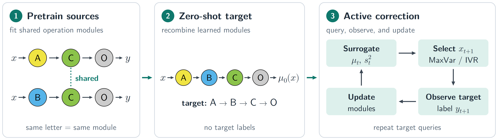
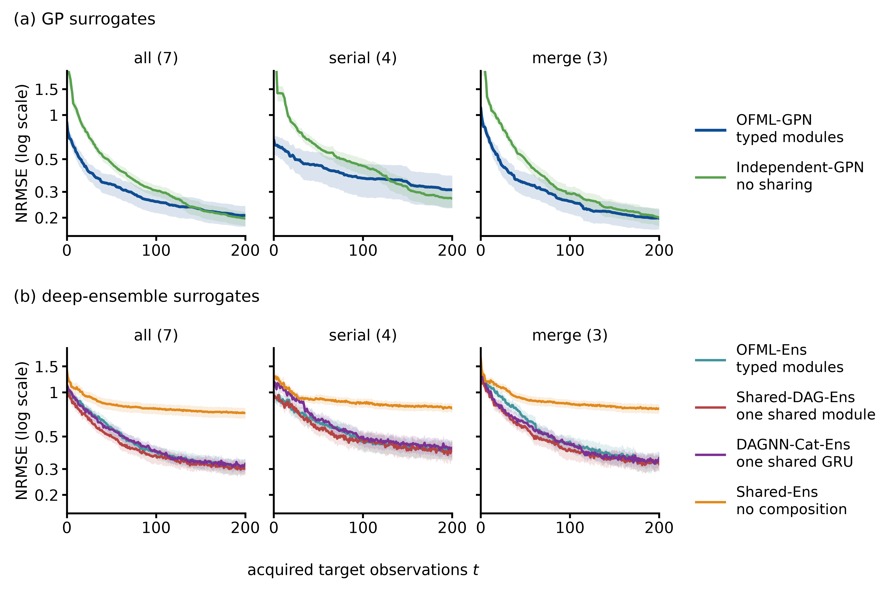
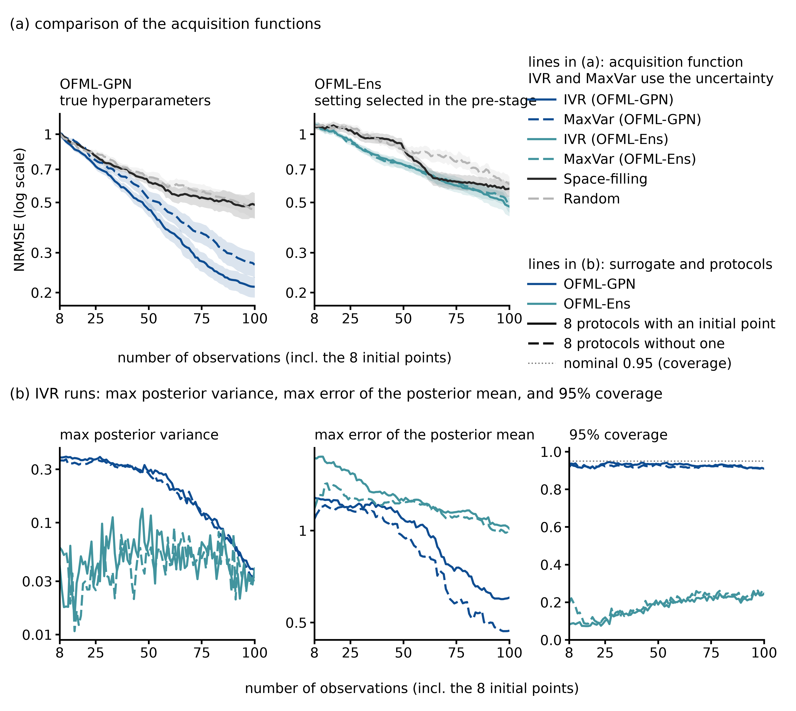

# Object-Flow Machine Learning: Operation-Level Surrogate Modeling for Self-Driving Laboratories

This repository is the official code and run records of the experiments in Sections 6.2 and 6.3 of the paper
**Object-Flow Machine Learning: Operation-Level Surrogate Modeling for Self-Driving Laboratories**
(Yusuke Ozaki, Kazunari Kaizu, Koichi Takahashi; arXiv link to be added).



Object-Flow Machine Learning (OFML) represents each experimental protocol as a typed directed acyclic graph of
operations, shares one module per operation type across protocols, composes the modules along the graph, and learns
only from terminal measurements. This enables zero-shot transfer to new protocols and adaptation from target
measurements. This repository reproduces every table and figure of the two experiments from the published run
records, and contains the code that produced those records.

## Contents

- [Repository structure](#repository-structure)
- [Requirements](#requirements)
- [Installation](#installation)
- [Reproducing the paper's tables and figures](#reproducing-the-papers-tables-and-figures)
- [Results](#results)
- [Tutorial: small runs of the models](#tutorial-small-runs-of-the-models)
- [Internal names](#internal-names)
- [License](#license)
- [Citation](#citation)

## Repository structure

```
├── transfer/              Section 6.2, transfer across protocols (code, run records, analysis; see transfer/README.md)
├── acquisition/           Section 6.3, acquisition functions and uniform consistency (see acquisition/README.md)
├── src/ofml/              operation modules used by the deep ensembles
├── third_party/gpn_smc/   OFML-GPN engine used by Section 6.3 (copy of the authors' code; see its PROVENANCE.md)
├── scripts/               reproduce_paper.sh, comparison with the paper, paths, figure style, tutorial check
└── docs/                  figures of this README
```

Each experiment directory has its own README with a file-by-file description, the command for each table and
figure, and the format of the run records. The run records (about 650 MB) are in the repository; checkpoints are not.

## Requirements

| Item | Requirement |
|---|---|
| OS | Linux (tested on Ubuntu 24.04) |
| Python | 3.12 (the paper's runs); >= 3.10 |
| Reproducing tables and figures; deep ensembles | CPU only |
| OFML-GPN, Independent-GPN | NVIDIA GPU with CUDA 12 (JAX 0.10.2); the paper used H100 NVL and Tesla V100 SXM2 |
| Time of the paper's runs (median per run) | OFML-GPN 15.1 h and Independent-GPN 3.9 h (Section 6.2), OFML-GPN 28.7 min (Section 6.3), on one GPU; deep ensembles 9.5 min to 13.5 h on one CPU thread |

## Installation

```bash
git clone https://github.com/ozatamago/ofml-release.git
cd ofml-release
python3.12 -m venv .venv
source .venv/bin/activate
pip install --upgrade pip
pip install -r requirements.txt --extra-index-url https://download.pytorch.org/whl/cpu
pip install -e .
```

`requirements.txt` pins the versions used for the paper; the `--extra-index-url` option installs the CPU build of
PyTorch (the deep ensembles ran on the CPU). For OFML-GPN, additionally install the CUDA build of JAX:

```bash
pip install "jax[cuda12]==0.10.2"
```

## Reproducing the paper's tables and figures

```bash
bash scripts/reproduce_paper.sh
```

This command regenerates, from the run records only, the tables, figures and appendix values listed below, prints
each value next to the value in the paper, and checks that the `.tex` tables are identical to those of the paper.
It uses the CPU only and takes about 30 seconds. Outputs go to `outputs/tables/` and `outputs/figures/`.

| Paper | Script | Details |
|---|---|---|
| Figure 3 (protocols of Section 6.2) | `transfer/analysis/plot_protocols.py` | [transfer/README.md](transfer/README.md) |
| Figure 4 and Table 2 (results of Section 6.2) | `transfer/analysis/plot_fig3_f4p_v2.py`, `make_table_obj1.py` | [transfer/README.md](transfer/README.md) |
| Numbers in the text of Section 6.2 (paired differences, coverage, input range of M) | `transfer/analysis/make_table_obj1_paired.py`, `coverage_by_t.py`, `transfer/gpn/analysis/p1_type_ranges.py` | [transfer/README.md](transfer/README.md) |
| Figure 5 (protocols of Section 6.3) | `acquisition/plot_protocols_w16u.py` | [acquisition/README.md](acquisition/README.md) |
| Figure 6 (results of Section 6.3) and the numbers in its text | `acquisition/make_fig_obj2_f4p_v2.py`, `fig_acquisition_values.py`, `make_table_obj2_paired.py` | [acquisition/README.md](acquisition/README.md) |
| Appendix: tab:gpm-paired, tab:gpm-exclusion, tab:gpm-fit | `transfer/analysis/` | [transfer/README.md](transfer/README.md) |
| Appendix: tab:acq-paired, tab:acq-sd-err, tab:acq-ens-settings, sec:acq-sensitivity | `acquisition/` | [acquisition/README.md](acquisition/README.md) |
| Appendix G: run times | `scripts/table_repro_time.py` | median wall-clock time per run, from the run records |

Figures 1 and 2 of the paper are diagrams of the method and of an example protocol, and Table 1 lists the factors of the
experiments; they contain no experimental
results and are not generated here.

## Results

### Section 6.2: transfer across protocols



**Figure 4.** NRMSE(t) against the number t of target observations selected by IVR after the source data D_0,
mean ± standard error over 12 true functions: (a) OFML-GPN and Independent-GPN, (b) the four deep-ensemble
surrogates; columns: all 7 target protocols, the 4 serial and the 3 merge targets. Command:
`cd transfer/analysis && python plot_fig3_f4p_v2.py --reps 2,4,5,9,11,12,15,17,19,23,27,28 --lang en --out ../../outputs/figures/fig_obj1_v2`.

**Table 2** (mean over the 12 true functions; bold = best in the column). Command:
`cd transfer/analysis && python make_table_obj1.py --reps 2,4,5,9,11,12,15,17,19,23,27,28 --suffix _v12`.

| Surrogate model | All: NRMSE(0) | All: NRMSE(T) | All: AULC(T) | Serial: NRMSE(0) | Serial: NRMSE(T) | Serial: AULC(T) | Merge: NRMSE(0) | Merge: NRMSE(T) | Merge: AULC(T) |
|---|---|---|---|---|---|---|---|---|---|
| OFML-GPN | **0.883** | 0.207 | **0.302** | **0.671** | 0.310 | **0.403** | **1.111** | **0.198** | **0.313** |
| Independent-GPN | 2.174 | **0.198** | 0.427 | 3.017 | **0.270** | 0.547 | 2.218 | 0.201 | 0.452 |
| OFML-Ens | 1.024 | 0.312 | 0.477 | 0.933 | 0.402 | 0.544 | 1.245 | 0.342 | 0.551 |
| Shared-DAG-Ens | 1.002 | 0.303 | 0.438 | 0.933 | 0.401 | 0.526 | 1.257 | 0.325 | 0.493 |
| DAGNN-Cat-Ens | 1.125 | 0.325 | 0.475 | 1.130 | 0.419 | 0.589 | 1.359 | 0.356 | 0.519 |
| Shared-Ens | 1.417 | 0.723 | 0.811 | 1.245 | 0.777 | 0.874 | 1.703 | 0.777 | 0.883 |

### Section 6.3: acquisition functions and uniform consistency



**Figure 6.** (a) NRMSE of OFML-GPN (left) and OFML-Ens (right) with four acquisition functions, mean ± standard error
over 16 true functions, against the number of observations including the 8 initial points. (b) With IVR, the maximum
posterior variance, the maximum absolute error of the posterior mean, and the 95% coverage, on the protocols with
(solid) and without (dashed) an initial point. Command:
`cd acquisition && python make_fig_obj2_f4p_v2.py runs/2026-11-04_main --ens-dir runs/prestage/prod_eval_fz/s04/ens --ens-label "selected setting" --lang en --out ../outputs/figures/fig_obj2_v2_s04`.

**Paired differences of AULC(T)** (appendix tab:acq-paired; mean, 95% bootstrap interval, and the number of true
functions on which the first acquisition function has the smaller AULC; the text of Section 6.3 quotes the first row).
Command: see [acquisition/README.md](acquisition/README.md).

| Comparison | OFML-GPN | OFML-Ens |
|---|---|---|
| IVR - Space-filling | -0.166 [-0.206, -0.135], 16/16 | -0.072 [-0.125, -0.022], 13/16 |
| MaxVar - Space-filling | -0.099 [-0.147, -0.048], 14/16 | -0.070 [-0.123, -0.017], 13/16 |
| Random - Space-filling | +0.019 [-0.016, +0.057], 8/16 | +0.058 [+0.017, +0.099], 6/16 |
| IVR - Random | -0.185 [-0.221, -0.153], 16/16 | -0.130 [-0.198, -0.071], 15/16 |
| MaxVar - Random | -0.119 [-0.174, -0.059], 14/16 | -0.128 [-0.198, -0.066], 13/16 |

## Tutorial: small runs of the models

Step 1 uses the CPU only and takes about 4 minutes; step 2 needs a GPU and takes about 5 minutes (measured on one
H100 NVL). Runs are written to `tutorial_runs/` (ignored by git).

**1. Deep ensembles with the paper's settings, shortened (CPU)**

```bash
cd transfer/ensembles
python p1_run.py --method ofml --problem rep:2 --T 10 --compile 1 --threads 1 \
    --config runs/hpo_2026-11-05_wide/selected_ofml.json --out ../../tutorial_runs/transfer_ensembles
cd ../../acquisition
python prestage/fz.py w16u_ens.py --reps 0 --policies ivr --config runs/prestage/configs/e5_shallow.json \
    --device cpu --threads 1 --out ../tutorial_runs/acquisition
cd ..
python scripts/check_tutorial.py
```

The first command runs OFML-Ens of Section 6.2 on true function 2 for the first 10 acquisitions (the paper:
`--T 200`; about 1 minute). The second runs OFML-Ens of Section 6.3 on true function 0 with IVR and the shallow
reference setting of the appendix (all 92 acquisitions; about 3 minutes; the main text uses `e5_s04.json`, which takes
about 13 hours per run). Both use the paper's settings (one CPU thread; `--compile 1` in Section 6.2; `prestage/fz.py`
in Section 6.3), so `check_tutorial.py` finds that their error curves equal the published run records. Without
`--compile 1` or with more threads the curves differ slightly, because the floating-point operations are ordered
differently.

**2. OFML-GPN with fewer particles (GPU)**

```bash
cd transfer/gpn
python run_p1_main.py --problem runs/p1_main/problems/rep_02.npz --particles 1024 --pcn-steps 8 --T 5 \
    --out ../../tutorial_runs/transfer_gpn
cd ../../acquisition
python w16u_gpn.py --reps 0 --policies ivr --particles 1024 --pcn-steps 8 --out ../tutorial_runs/acquisition
cd ..
python scripts/check_tutorial.py --gpu
```

The first command assimilates the 80 source observations (D_0) and 5 target observations (about 2.5 minutes); the
second runs all 92 acquisitions of Section 6.3 (about 2 minutes). The paper used 16384 particles and 96 pCN updates
(the defaults) and `--T 200` in Section 6.2, so the numbers differ from the run records; with 1024 particles the
exclusion rule of Section 6.2 may be hit (the record then says `"excluded": true`). `--pcn-steps` must be a
multiple of 8.

**Japanese figures.** The figure scripts accept `--lang ja`. This needs the Harano Aji Gothic font (SIL Open Font
License 1.1, <https://github.com/trueroad/HaranoAjiFonts>): put its OpenType files in `fonts/` (or set
`OFML_JA_FONT_DIR`) and run `python scripts/otf2ttf_haranoaji.py fonts` (`pip install fonttools`). The Japanese
fig:exp-acquisition of the paper was made with `--ens-label 前段階で選んだ設定`.

## Internal names

The file and directory names of the code and the run records keep the names used while the experiments were run.

| Internal name | Meaning |
|---|---|
| `p1`, `PB-P1-DRAFT` | the experiment of Section 6.2 and its benchmark |
| `w16u`, `PB-W16U` | the experiment of Section 6.3 and its benchmark family |
| `obj1`, `obj2` (figure and table scripts) | Section 6.2, Section 6.3 |
| `rep_NN` | true function NN |
| `ofml_gpn`, `indep_gpn` | OFML-GPN, Independent-GPN |
| `ofml`, `sharedcell`, `dagnn_cat`, `shared` | OFML-Ens, Shared-DAG-Ens, DAGNN-Cat-Ens, Shared-Ens |
| `prestage` | the selection of the OFML-Ens setting before the evaluation runs (Appendix F) |
| `s04`, `p02`, `shallow`, `ens_v2` | OFML-Ens settings: the main text, p02, the shallow reference, the old setting |
| `xeon6130-v100`, `xeon6530-h100nvl` | the two machines (2x Xeon Gold 6130 with 8x Tesla V100 SXM2; 2x Xeon Gold 6530 with 2x H100 NVL) |

Comments in the code refer to design notes (`REPORTS/...`) that are not part of this repository. The Slurm scripts
record how the paper's runs were submitted on the authors' cluster; set `OFML_ROOT` to the repository root and `PY`
to the Python interpreter, and adapt the `#SBATCH` lines to your cluster.

## License

MIT (see [LICENSE](LICENSE)). The run records are distributed under the same terms. The dependencies are separate
projects under their own licenses. The Harano Aji fonts are not included.

## Citation

```bibtex
@article{ozaki2026ofml,
  title   = {Object-Flow Machine Learning: Operation-Level Surrogate Modeling for Self-Driving Laboratories},
  author  = {Ozaki, Yusuke and Kaizu, Kazunari and Takahashi, Koichi},
  journal = {arXiv preprint},
  year    = {2026}
}
```
