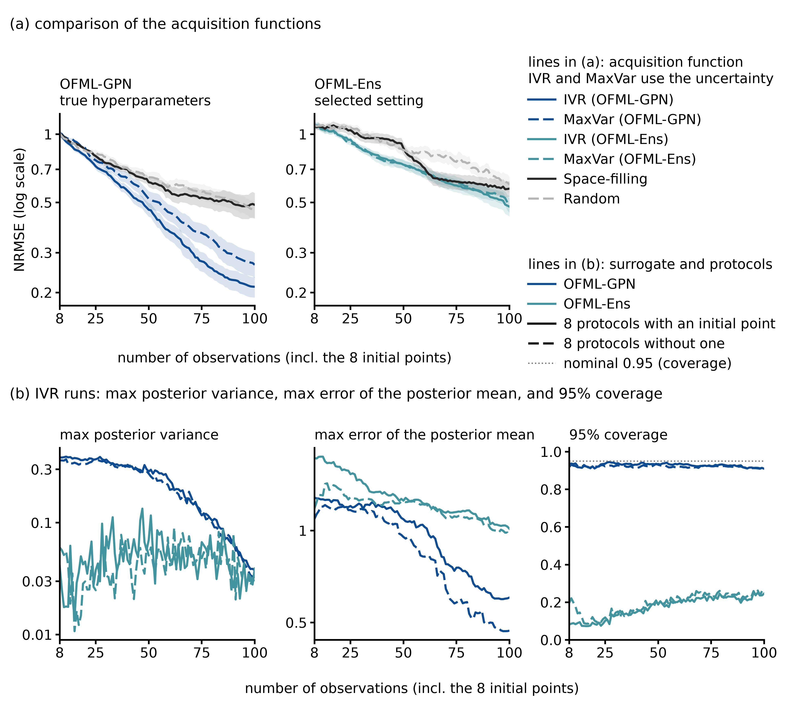

# Section 6.3: Acquisition functions and uniform consistency

This directory contains the code and run records of Section 6.3 of the paper and of its appendix. On the benchmark
family PB-W16U (16 protocols: 2 first-layer operation types x 8 second-layer operation types, 64 grid points each,
1024 candidates; 8 initial points, one in each even-numbered protocol), OFML-GPN and OFML-Ens add 92 observations
with four acquisition functions (IVR, MaxVar, space-filling, random). 16 true functions are evaluated; 32 other true
functions were used only to select the setting of OFML-Ens. The internal name of this experiment is `w16u`.



## Contents

```
acquisition/
├── w16u_common.py              the benchmark: grid, protocols, initial points, true functions (teachers/), acquisition functions
├── w16u_gpn.py                 OFML-GPN runs (imports third_party/gpn_smc; JAX, GPU)
├── w16u_ens.py                 OFML-Ens runs (PyTorch, CPU); run through prestage/fz.py as in the paper
├── analyze_w16u.py             AULC, final error and paired bootstrap differences (summary.json)
├── make_table_obj2_paired.py   tab:acq-paired
├── make_fig_obj2_f4p_v2.py     fig:exp-acquisition (uses plot_w16u_uniform_split.py for panel (b))
├── plot_protocols_w16u.py      fig:exp-acq-protocols
├── fig_acquisition_values.py   values of fig:exp-acquisition (b) quoted in the text of Section 6.3
├── sd_err_calibration.py       tab:acq-sd-err
├── table_acq_ens_settings.py   tab:acq-ens-settings
├── sensitivity_p1_rule.py      sec:acq-sensitivity: exclusion rule of Section 6.2 and the paired AULC difference
├── sensitivity_p1_rule_fig4b.py  sec:acq-sensitivity: panel (b) quantities on the remaining true functions
├── make_teachers.py            generation of teachers/ (needs the authors' unpublished cx_bayes; the cache is published)
├── teachers/                   true functions: rep_0000-0015 (evaluation), rep_1000-1031 (setting selection of OFML-Ens)
├── configs/                    earlier OFML-Ens settings (ens_selected_2026-11-04_v2.json = the old setting)
├── prestage/                   selection of the OFML-Ens setting (ps_search.py, ps_trial.py, ps_e3.py, ps_e5.py),
│                               fz.py (flushes subnormal numbers to zero; the production path of w16u_ens.py)
├── slurm/                      job scripts of the paper's runs
└── runs/                       run records (below)
```

## Reproducing the tables and figures

All commands run in `acquisition/` and read only the run records (CPU, seconds each).
`bash ../scripts/reproduce_paper.sh` runs all of them and compares the results with the paper.

| Paper | Command | Run records |
|---|---|---|
| tab:acq-paired (the text of Section 6.3 quotes its first row) | `python analyze_w16u.py runs/2026-11-04_main --ens-dir ../prestage/prod_eval_fz/s04/ens --outdir runs/2026-11-04_main/analysis_s04`, then `python make_table_obj2_paired.py runs/2026-11-04_main analysis_s04` | `runs/2026-11-04_main/gpn`, `runs/prestage/prod_eval_fz/s04/ens` |
| fig:exp-acquisition | `python make_fig_obj2_f4p_v2.py runs/2026-11-04_main --ens-dir runs/prestage/prod_eval_fz/s04/ens --ens-label "selected setting" --lang en --out ../outputs/figures/fig_obj2_v2_s04` | same, and `teachers/` |
| values of fig:exp-acquisition (b) in the text of Section 6.3 | `python fig_acquisition_values.py` | `runs/2026-11-04_main/gpn`, `runs/prestage/prod_eval_fz/s04/ens`, `teachers/` |
| tab:acq-sd-err | `python sd_err_calibration.py runs/2026-11-04_main $PWD/runs/prestage/prod_eval_fz/s04/ens` | same |
| tab:acq-ens-settings | `python table_acq_ens_settings.py` | `runs/prestage/prod_eval_fz/{s04,p02,shallow}/ens`, `runs/2026-11-04_main/ens_v2` |
| tab:acq-ens-selection | values of `runs/prestage/e5/summary.json` (`val` = J of the search, `J_cpu` = J of the confirmation, `kappa_bar_cpu`) | `runs/prestage/{e4,e5,configs}` |
| sec:acq-sensitivity | `python sensitivity_p1_rule.py runs/2026-11-04_main` and `python sensitivity_p1_rule_fig4b.py` | `runs/2026-11-04_main/gpn` |
| sec:acq-preregistered | field `exclusion` of `runs/2026-11-04_main/gpn/*.json`; `analyze_w16u.py` reports `"excluded": {}` | same |
| fig:exp-acq-protocols | `python plot_protocols_w16u.py --lang en` | none |

## Run records

| Directory | Contents |
|---|---|
| `runs/2026-11-04_main/gpn/` | `rep_XXXX_<policy>.json`: configuration, observed points, per-round NRMSE, maximum variance, maximum error, coverage, effective sample sizes, pre-registered exclusion decision, wall-clock time; `rep_XXXX_<policy>.npz`: posterior mean, variance and PIT on all 1024 candidates at every round; `hosts.json`: machine of each true function |
| `runs/prestage/prod_eval_fz/s04/ens/` | the same for OFML-Ens with the setting of the main text (`runs/prestage/configs/e5_s04.json`) |
| `runs/prestage/prod_eval_fz/{p02,shallow}/ens/`, `runs/2026-11-04_main/ens_v2/` | OFML-Ens with the settings p02, the shallow reference and the old setting (tab:acq-ens-settings) |
| `runs/prestage/e4/`, `e5/`, `e6/` | selection of the OFML-Ens setting: trials (`e4/trials/`), confirmation on the CPU (`e5/summary.json`), the additional search for p02 (`e6/`) |
| `runs/prestage/configs/` | the candidate settings (`e5_<name>.json`) |
| `runs/prestage/prod_eval/prod_eval_fz.cmds` | the commands of the paper's OFML-Ens runs (one per line) |

The JSON records of OFML-GPN store `teacher_sha256` of (truth, noisy - truth) and those of OFML-Ens of
(truth, noise); the two hashes differ by floating-point rounding only, and `w16u_common.load_teacher` checks the
teacher whenever it is read.

## Running the experiment

The paper's settings are the defaults of the run scripts, except the OFML-Ens setting, which is given as a file:

```bash
cd acquisition
python w16u_gpn.py --reps 0 --policies ivr,maxvar,spacefill,random --out <dir>        # 16384 particles, 96 pCN updates
python prestage/fz.py w16u_ens.py --reps 0 --policies ivr --config runs/prestage/configs/e5_s04.json \
    --device cpu --threads 1 --out <dir>
```

One OFML-GPN run took a median of 28.7 minutes (excluding the assimilation of the shared initial points); one
OFML-Ens run took a median of 13.5 hours on one CPU thread. The job scripts are in `slurm/` and `prestage/cpu_cmds.sbatch`.
