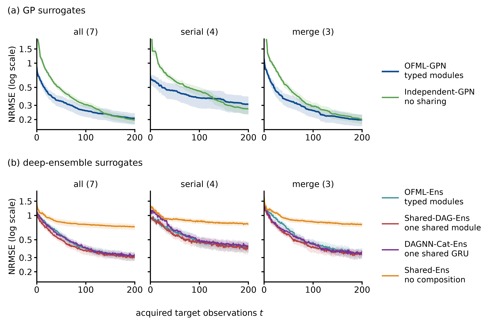

# Section 6.2: Transfer across protocols

This directory contains the code and run records of Section 6.2 of the paper and of its appendix. Six surrogate
models (OFML-GPN, Independent-GPN, OFML-Ens, Shared-DAG-Ens, DAGNN-Cat-Ens, Shared-Ens) learn from the observations of
10 source protocols, predict 7 target protocols without target observations (zero-shot), and are then adapted with
200 target observations selected by IVR. The true function of each operation type is drawn from a Gaussian process;
12 true functions enter the comparison. The internal name of this experiment is `p1`.



## Contents

```
transfer/
├── gpn/                              OFML-GPN and Independent-GPN (JAX, GPU)
│   ├── ofml_gpn/                     the GPN engine: SMC over operation-level Gaussian-process networks (see PROVENANCE.md)
│   ├── p1_common.py                  the benchmark: protocol terms, grid, true-function draws, noise, IVR
│   ├── p1_gpn_tools.py               SMC system wrapper and posterior summaries (mean, covariance, PIT) on the targets
│   ├── run_p1_main.py                one run of OFML-GPN (assimilates D_0, then 200 IVR acquisitions)
│   ├── run_p1_indep.py               one run of Independent-GPN (one composition per protocol, no shared modules)
│   ├── run_p1_smoke.py               short test run
│   ├── analysis/p1_type_ranges.py    input and output ranges of each operation type (sec:gpm-bench)
│   ├── scripts/p1_status.py          progress of a set of runs
│   ├── scripts/extract_stopped_rounds.py   extraction of the records of stopped runs from their checkpoints
│   └── runs/p1_main/                 run records (below)
├── ensembles/                        the four deep ensembles (PyTorch, CPU)
│   ├── p1_models.py                  OFML-Ens, Shared-DAG-Ens, DAGNN-Cat-Ens, Shared-Ens and the ensemble trainer
│   ├── p1_run.py                     one run of one ensemble (same protocol as run_p1_main.py)
│   ├── p1_hpo.py                     hyperparameter search (Sobol, then GP + EI) on the 4 tuning functions
│   ├── bench_fit.py, configs/        timing benchmark of the trainer
│   ├── slurm/                        job scripts of the paper's runs
│   └── runs/                         run records (below)
└── analysis/                         tables, figures and appendix values (all read the run records only)
    ├── make_table_obj1.py            tab:exp-transfer
    ├── make_table_obj1_paired.py     tab:gpm-paired (uses paired_stats.py)
    ├── plot_fig3_f4p_v2.py           fig:exp-transfer
    ├── plot_protocols.py             fig:exp-protocols
    ├── table_exclusion.py            tab:gpm-exclusion and runs/p1_main/exclusion/judgments.csv
    ├── coverage_by_t.py              95% coverage of OFML-GPN (sec:gpm-exclusion)
    ├── p1_fit_check.py               refits of the ensembles at t = 0, 50, 100, 200 (tab:gpm-fit); outputs in fit12/
    └── table_gpm_fit.py              tab:gpm-fit (means over the 12 true functions)
```

## Reproducing the tables and figures

All commands run in `transfer/analysis/` and read only the run records (CPU, seconds each).
`bash ../../scripts/reproduce_paper.sh` runs all of them and compares the results with the paper.

| Paper | Command | Run records |
|---|---|---|
| fig:exp-transfer | `python plot_fig3_f4p_v2.py --reps 2,4,5,9,11,12,15,17,19,23,27,28 --lang en --out ../../outputs/figures/fig_obj1_v2` | `gpn/runs/p1_main/{ofml_gpn,indep_gpn}`, `ensembles/runs/main_2026-11-08` |
| tab:exp-transfer | `python make_table_obj1.py --reps 2,4,5,9,11,12,15,17,19,23,27,28 --suffix _v12` | same |
| tab:gpm-paired (the text of Section 6.2 quotes the OFML-GPN - Independent-GPN rows) | `python make_table_obj1_paired.py` | same |
| tab:gpm-exclusion | `python table_exclusion.py` | `gpn/runs/p1_main/{ofml_gpn,indep_gpn}` including `stopped/` |
| coverage in sec:gpm-exclusion | `python coverage_by_t.py 2,4,5,9,11,12,15,17,19,23,27,28` (row "平均" of "全体") | `gpn/runs/p1_main/ofml_gpn/*.npz` |
| input range of M (sec:gpm-bench; the text quotes about 15%) | `cd ../gpn && JAX_PLATFORMS=cpu OFML_GPN_ALLOW_ANY_GRID=1 python analysis/p1_type_ranges.py` (row M: 1 - mean) | none (12 true functions drawn apart from the comparison) |
| tab:gpm-fit | `python table_gpm_fit.py` | `analysis/fit12/` (outputs of `p1_fit_check.py`, commands in `fit12/cmds.txt`) |
| tab:gpm-hpo | values of `selected_<method>.json` | `ensembles/runs/hpo_2026-11-05_wide/` |
| fig:exp-protocols | `python plot_protocols.py --lang en` | none |

The `.tex` tables are written to `outputs/tables/`, the figures to `outputs/figures/`.

## Run records

| Directory | Contents |
|---|---|
| `gpn/runs/p1_main/problems/` | `rep_NN.npz`: true function NN (operation functions on the grid, noise, D_0); `tune_NN.npz`: the 4 tuning functions |
| `gpn/runs/p1_main/ofml_gpn/`, `indep_gpn/` | `rep_NN.json`: configuration, status, exclusion decision, per-observation records (`rounds`: effective sample size, wall-clock time), NRMSE(t), AULC; `rep_NN.npz`: posterior mean, variance and PIT on the 448 target points at every t |
| `gpn/runs/p1_main/<method>/stopped/` | per-observation records of the runs stopped before T = 200 |
| `gpn/runs/p1_main/exclusion/judgments.csv` | exclusion decision for every drawn true function (Appendix E.6) |
| `gpn/runs/p1_main/auto/` | log of the replacement procedure (`state.json`, `events.log`) |
| `gpn/runs/p1_main/diag/` | the test with 4x particles and 4x pCN updates (sec:gpm-exclusion) |
| `ensembles/runs/main_2026-11-08/<method>/` | `rep_NN.json` (configuration, NRMSE(t), chosen points, fit times), `rep_NN.npz` (posterior mean and variance) for `ofml` (OFML-Ens), `sharedcell` (Shared-DAG-Ens), `dagnn_cat` (DAGNN-Cat-Ens), `shared` (Shared-Ens) |
| `ensembles/runs/hpo_2026-11-05/`, `hpo_2026-11-05_wide/` | hyperparameter search (`<method>.jsonl`) and the selected settings (`selected_<method>.json`) |

The true functions 0-15 were drawn first; 16-28 were drawn in order to replace the excluded ones until 5 comparable
functions were collected; 29-33 were run afterwards and are not used. The comparison uses
2, 4, 5, 9, 11, 12, 15, 17, 19, 23, 27, 28.

## Running the experiment

The paper's settings are the defaults of the run scripts. One run of each model on true function NN:

```bash
cd transfer/gpn
python run_p1_main.py  --problem runs/p1_main/problems/rep_NN.npz --out <dir>   # OFML-GPN: 16384 particles, 96 pCN updates
python run_p1_indep.py --problem runs/p1_main/problems/rep_NN.npz --out <dir>   # Independent-GPN: 65536 particles, 384 pCN updates
cd ../ensembles
python p1_run.py --method ofml --problem rep:NN --compile 1 --threads 1 \
    --config runs/hpo_2026-11-05_wide/selected_ofml.json --out <dir>           # also sharedcell, dagnn_cat, shared
```

OFML-GPN took a median of 15.1 hours per run and Independent-GPN 3.9 hours (V100 and H100 NVL); the ensembles took
10 to 41 minutes on one CPU thread. The job scripts of the paper are in `gpn/runs/p1_main/slurm/` (`p1_rep.sbatch`
for the first 16 functions; `p1_auto.py` for the replacement procedure, with `--abort-on-exclusion`) and
`ensembles/slurm/`.
